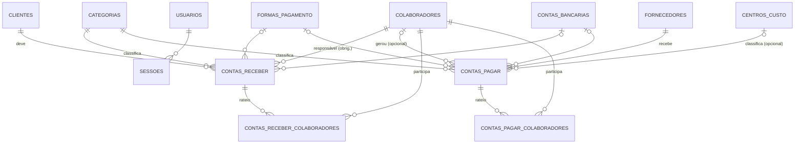

# Openway Financeiro — Documento de Arquitetura

Sistema de **Contas a Pagar e Contas a Receber** para gestão **Pessoal e Empresarial** no mesmo ambiente, com dashboard executivo, rateio de receitas e despesas por colaborador e controle de acesso por login.

---

## 1. Visão geral e stack

| Camada | Tecnologia | Motivo |
|---|---|---|
| Banco de dados | **PostgreSQL (Neon)**, via driver `pg` (conexão em `DATABASE_URL`) | Banco na nuvem, transacional (ACID), acessível pelo PC e pelo Netlify; histórico/restore no painel do Neon. Front-end estático no CDN do Netlify e API Express como Netlify Function. |
| Back-end | **Node.js + Express 5** (API REST JSON) | Leve, roda em qualquer Windows com Node LTS. |
| Autenticação | Sessão por token aleatório (cookie `HttpOnly`, `SameSite=Lax`, 12 h) + senhas com **bcrypt** | Simples e seguro para uso local / rede interna. |
| Front-end | SPA em **HTML/CSS/JS puro** + **Chart.js** | Sem build step; abre direto no navegador. Tema escuro corporativo com a identidade Openway. |

```
┌──────────────┐   HTTP/JSON    ┌────────────────────────┐   SQL    ┌──────────────────┐
│  Navegador   │ ─────────────▶ │  Express (src/server)  │ ───────▶ │ PostgreSQL (Neon) │
│  SPA public/ │ ◀───────────── │  auth · cadastros ·    │ ◀─────── │ tabelas + views   │
└──────────────┘                │  lançamentos · dashboard│         └──────────────────┘
                                └────────────────────────┘
```

### Estrutura de pastas

```
database/schema.sql       Schema oficial (tabelas, índices, views) – aplicado automaticamente
database/schema.prisma    Mesmo modelo em Prisma (referência p/ migração a Prisma/PostgreSQL)
src/server.js             Bootstrap do Express, segurança e tratamento de erros
src/db.js                 Conexão PostgreSQL (pg, assíncrona), aplicação do schema, dados auxiliares padrão
src/auth.js               Login, setup do 1º admin, sessão, troca de senha, CRUD de usuários
src/routes/cadastros.js   CRUD genérico: categorias, clientes, fornecedores, colaboradores, formas de pgto, contas bancárias
src/routes/lancamentos.js Contas a Receber / Pagar (CRUD, baixa, estorno, rateio)
src/routes/dashboard.js   Dashboard executivo e resumo por colaborador
src/seed.js               Dados de demonstração
public/                   Front-end (index.html, css/, js/, img/)
test/api.test.js          Testes de integração da API
```

---

## 2. Modelo de dados



### 2.1 Cadastros base

| Tabela | Campos principais | Observações |
|---|---|---|
| `categorias` | `nome`, `tipo` (RECEITA/DESPESA), `natureza` (PESSOAL / EMPRESA / **AMBOS**), `ativo` | Plano de contas. `AMBOS` = “Empresa e Pessoal”: a mesma categoria serve aos dois ambientes. Único por (nome, tipo, natureza). |
| `clientes` | `nome` (Nome/Razão Social), `cpf_cnpj`, `contato`, `email`, `telefone`, `ativo` | CPF/CNPJ validado pelos dígitos verificadores; único quando informado. |
| `fornecedores` | idem clientes | |
| `colaboradores` | `nome`, `cargo`, `status` (ATIVO/INATIVO) | |
| `centros_custo` | `codigo` (opcional, ex.: 1.01), `nome`, `descricao`, `ativo` | Classificação gerencial das despesas (departamento, projeto, filial). Nome e código únicos. |
| `formas_pagamento` | `nome`, `ativo` | Expansão sugerida (Pix, Boleto, Cartão...). Pré-carregada. |
| `contas_bancarias` | `nome`, `banco`, `agencia`, `conta`, `natureza`, `ativo` | Expansão sugerida (onde o dinheiro entrou/saiu). |

### 2.2 Lançamentos

| Campo | Contas a Receber | Contas a Pagar |
|---|---|---|
| `nro_documento` | PK **autoincremental** (sequência própria) | PK **autoincremental** (sequência própria) |
| `data_emissao` / `data_vencimento` | obrigatórias (vencimento ≥ emissão) | idem |
| `data_pagamento` | opcional → preenchida = **recebido** | opcional → preenchida = **liquidado** |
| `tipo_ambiente` | PESSOAL / EMPRESA | PESSOAL / EMPRESA |
| parte | `cliente_id` (obrig.) | `fornecedor_id` (obrig.) |
| `categoria_id` | categoria de **RECEITA** | categoria de **DESPESA** |
| `colaborador_id` | **obrigatório** (responsável) | **opcional** |
| `valor_centavos` | > 0 | > 0 |
| `observacoes` | texto livre | texto livre |
| `centro_custo_id` | — | **opcional** (Centro de Custo) |
| `forma_pagamento_id`, `conta_bancaria_id` | opcionais | opcionais |
| auditoria | `criado_por`, `criado_em`, `atualizado_em` | idem |
| `projetado_de` | nº do título de origem quando criado pela Projeção de Mês | idem |

### 2.3 Rateio por colaborador (opcional, N por título)

`contas_receber_colaboradores` e `contas_pagar_colaboradores` — (`nro_documento`, `colaborador_id`, `valor_centavos`), único por (título, colaborador). Validação: **soma do rateio ≤ valor do título**.

### 2.4 Convenções

- **Dinheiro em centavos (INTEGER)** — elimina erros de arredondamento de ponto flutuante.
- **Datas ISO `AAAA-MM-DD`** — ordenáveis e comparáveis como texto.
- **Status não é gravado**, é derivado em tempo de consulta (nunca fica desatualizado).
- **Integridade referencial** ativa (`PRAGMA foreign_keys = ON`): um cadastro usado em lançamentos não pode ser excluído — deve ser **inativado**.

---

## 3. Regras de negócio

### 3.1 Status do título

```sql
CASE WHEN data_pagamento IS NOT NULL      THEN 'REALIZADO'   -- Realizado / Liquidado
     WHEN data_vencimento < :hoje          THEN 'ATRASADO'    -- Em Atraso
     ELSE                                       'PENDENTE' END -- Pendente
```

### 3.2 Princípio da Entidade (Pessoal x Empresa)

- Todo título tem `tipo_ambiente` (PESSOAL ou EMPRESA) — é ele que separa os resultados, não a categoria.
- Categorias de natureza **Empresa e Pessoal (`AMBOS`)** podem ser usadas nos dois ambientes (ex.: “Tarifas Bancárias”, “Energia Elétrica”), evitando cadastros duplicados.
- Categorias “Somente Empresa” / “Somente Pessoal”: a API **recusa** um título de outro ambiente (ex.: “Moradia/PESSOAL” num título EMPRESA).
- O formulário lista as categorias do **tipo** correto (Receita/Despesa) com natureza igual ao ambiente escolhido **ou** “Empresa e Pessoal”.
- Não é permitido mudar o **tipo** de uma categoria já usada, nem restringir a natureza (ex.: de “Empresa e Pessoal” para “Somente Empresa”) se houver lançamentos no outro ambiente.
- O filtro global de **Âmbito** (Todas / Apenas Pessoal / Apenas Empresa) é aplicado a todos os cards, gráficos, listas e ao resumo por colaborador.

### 3.3 Atribuição de valores a colaboradores (view `v_atribuicao_colaborador`)

1. Cada linha de **rateio** atribui seu valor ao colaborador informado.
2. O **saldo não rateado** (valor do título − soma do rateio) vai para o `colaborador_id` do título (responsável). Sem rateio → 100% para ele.
3. Em Contas a Pagar, se não houver colaborador nem rateio, a despesa é “geral” (não atribuída a ninguém).

> Consequência: em Contas a Receber, a soma por colaborador **sempre fecha** com o total de receitas.

Exemplo: título de R$ 10.000,00, responsável Ana, rateio Bruno R$ 3.000,00 e Carla R$ 2.500,50 → Bruno 3.000,00 · Carla 2.500,50 · **Ana 4.499,50**.

---

## 4. Rotas da API e regras de cálculo do Dashboard

Todas as rotas `/api/*` (exceto `/api/auth/status|setup|login|logout`) exigem sessão.

### 4.1 Endpoints

| Método | Rota | Descrição |
|---|---|---|
| POST | `/api/auth/setup` | Cria o 1º administrador (só com banco vazio) |
| POST | `/api/auth/login` · `/logout` · `/senha` | Sessão e troca de senha (bloqueio após 5 tentativas / 15 min) |
| CRUD | `/api/usuarios` | Gestão de usuários (somente ADMIN) |
| CRUD | `/api/cadastros/{categorias\|clientes\|fornecedores\|colaboradores\|formas-pagamento\|contas-bancarias}` | Cadastros base (`?q=` busca, filtros por `tipo`, `natureza`, `ativo`, `status`) |
| GET | `/api/receber` · `/api/pagar` | Lista com filtros: `de`, `ate`, `base` (vencimento\|pagamento\|emissao), `ambiente`, `status` (PENDENTE\|ATRASADO\|REALIZADO\|ABERTO), `categoria_id`, `colaborador_id`, `q`. Retorna `itens` + `totais` por status |
| POST/PUT/DELETE | `/api/receber[/:nro]` · `/api/pagar[/:nro]` | CRUD do título, incluindo `rateio: [{colaborador_id, valor_centavos}]` |
| PATCH | `/api/{receber\|pagar}/:nro/baixa` | Liquida: `data_pagamento` (padrão hoje), forma e conta |
| PATCH | `/api/{receber\|pagar}/:nro/estorno` | Remove a data de pagamento |
| GET | `/api/dashboard?de&ate&ambiente` | Dados do dashboard (abaixo) |
| GET | `/api/resumo-centros-custo?de&ate&ambiente[&centro_custo_id=ID\|SEM]` | Despesas por Centro de Custo (KPIs, por centro, série empilhada, categorias, fornecedores) |
| GET | `/api/projecao/preview?origem=AAAA-MM&destino=AAAA-MM[&tipo=receber\|pagar][&ambiente]` | Prévia da Projeção de Mês (datas projetadas, aviso de já projetado) |
| POST | `/api/projecao/executar` | Gera os títulos: `{ origem, destino, itens: [{ tipo, nro_documento, valor_centavos? }] }` |
| POST | `/api/importacao/pagar/preview` | Lê a planilha (base64 .xlsx/.csv) e devolve linhas, pendências, unificações e cadastros novos |
| POST | `/api/importacao/pagar/executar` | Grava as linhas revisadas e cria os cadastros faltantes (transação única) |
| GET | `/api/admin/estatisticas` | Contagem de registros (ADMIN) |
| POST | `/api/admin/zerar` | `{ modo: 'lancamentos'\|'tudo', confirmacao: 'ZERAR' }` — backup automático + limpeza + numeração reiniciada (ADMIN) |
| GET | `/api/resumo-colaboradores?de&ate&ambiente[&inativos=1]` | Receita x Despesa por colaborador |
| GET | `/api/resumo-colaboradores/:id?de&ate&ambiente` | Extrato de títulos atribuídos ao colaborador |

### 4.2 Regras de cálculo — `GET /api/dashboard`

Parâmetros: período `[de, ate]` (inclusivo) e `ambiente` ∈ {TODAS, PESSOAL, EMPRESA}. Seja **A** o filtro de ambiente (`1=1` quando TODAS).

| Indicador | Fórmula |
|---|---|
| **Receitas Previstas** | Σ `valor` de `contas_receber` com `data_vencimento ∈ [de,ate]` ∧ A (pagas **ou** não — “a receber + recebidas”) |
| **Despesas Previstas** | Σ `valor` de `contas_pagar` com `data_vencimento ∈ [de,ate]` ∧ A |
| **Receitas Realizadas** | Σ `valor` de `contas_receber` com `data_pagamento ∈ [de,ate]` ∧ A (regime de caixa) |
| **Despesas Realizadas** | Σ `valor` de `contas_pagar` com `data_pagamento ∈ [de,ate]` ∧ A |
| **Resultado Final Previsto** | Receitas Previstas − Despesas Previstas |
| **Resultado Final Realizado** | Receitas Realizadas − Despesas Realizadas |
| Em aberto (apoio) | Σ vencimento no período ∧ `data_pagamento IS NULL` |
| Em atraso (apoio) | Σ vencimento no período ∧ `data_pagamento IS NULL` ∧ `data_vencimento < hoje` |
| Margem prevista | Resultado Previsto ÷ Receitas Previstas |

> **Por que datas diferentes para previsto e realizado?** O previsto responde “o que estava programado para o período” (vencimento). O realizado responde “o que efetivamente entrou/saiu do caixa no período” (pagamento). Um título vencido em agosto e pago em setembro aparece no previsto de agosto e no realizado de setembro — é o comportamento correto de um fluxo de caixa.

**Série temporal (Receitas x Despesas no tempo)**
- Granularidade automática: **diária** se o período tem ≤ 31 dias; **mensal** caso contrário. Todos os “baldes” do período são gerados (inclusive vazios), para o eixo X ser contínuo.
- 4 séries: receita prevista (agrupada por `data_vencimento`), receita realizada (por `data_pagamento`), despesa prevista, despesa realizada.

**Status dos Títulos (rosca)**
- Universo: títulos (receber, pagar ou ambos) com `data_vencimento ∈ [de,ate]` ∧ A.
- Percentual por **quantidade** de títulos em cada status; o valor financeiro de cada fatia também é retornado.

**Detalhamento por colaborador**
- Base: `v_atribuicao_colaborador` (regra 3.3), filtrada por A.
- Ranking de receitas: por colaborador, `previsto` = Σ atribuído com vencimento no período; `realizado` = Σ atribuído com pagamento no período. Ordenado por previsto desc.
- Despesas atreladas: mesma regra sobre Contas a Pagar.

**Extras**: Top 8 categorias (receitas e despesas, previsto x realizado) e lista dos 10 títulos em aberto mais antigos (próximos vencimentos e atrasos).

### 4.3 Resumo por Colaborador — `GET /api/resumo-colaboradores`

Para cada colaborador: `receita_prevista`, `receita_realizada`, `despesa_prevista`, `despesa_realizada`, **`saldo_previsto`** (= receita − despesa previstas), **`saldo_realizado`**, `roi_previsto` (receita ÷ despesa), quantidade de títulos a receber/pagar. Ordenado por saldo previsto. Inativos sem movimento ficam ocultos (opção `inativos=1`).

---

### 4.4 Despesas por Centro de Custo — `GET /api/resumo-centros-custo`

Universo: `contas_pagar` filtrado por período, âmbito e (opcional) centro de custo — `centro_custo_id=ID` ou `SEM` (títulos sem centro).

| Indicador | Fórmula |
|---|---|
| Previsto | Σ valor com `data_vencimento ∈ [de,ate]` |
| Realizado | Σ valor com `data_pagamento ∈ [de,ate]` |
| Em aberto / Em atraso | vencimento no período, sem pagamento (e, para atraso, vencimento < hoje) |
| Sem centro de custo | Σ previsto dos títulos com `centro_custo_id IS NULL` (indicador de qualidade da classificação) |
| Por centro | mesmas métricas agrupadas por `centro_custo_id`; títulos sem centro formam o grupo “Sem centro de custo”. A soma dos grupos fecha com o total. |
| Série temporal | empilhada por centro (5 maiores + “Outros centros” + “Sem centro de custo”), previsto por vencimento ou realizado por pagamento; mesma granularidade do dashboard |
| Categorias / Fornecedores | top 10 dentro do filtro |

Cores: cada centro mantém a mesma cor em todos os gráficos (ordem do cadastro, até 5 centros); “Outros” e “Sem centro” usam cinzas neutros. O dashboard principal também mostra o card **Despesas por Centro de Custo** (top 8).

### 4.5 Projeção de Mês — `/api/projecao/*`

Objetivo: evitar relançar despesas e receitas que se repetem todo mês.

1. **Seleção**: títulos com `data_vencimento` dentro do mês de origem (filtros opcionais: Receber/Pagar e ambiente). Pagos ou não.
2. **Datas**: emissão e vencimento avançam a diferença de meses entre origem e destino, **mantendo o dia**; se o dia não existir no mês de destino, usa o último dia (31/01 → 28/02).
3. **Novo título**: `data_pagamento` vazia (status PENDENTE ou EM ATRASO conforme o vencimento), novo `nro_documento` sequencial e `projetado_de` = nº de origem. Copia ambiente, cliente/fornecedor, categoria, colaborador, centro de custo, forma de pagamento, conta bancária, observações e rateio.
4. **Valor**: pode ser alterado por item na prévia; se o novo valor for menor que a soma do rateio, o rateio é reduzido proporcionalmente (a soma nunca ultrapassa o valor).
5. **Duplicidade**: a prévia marca como “já projetado” (e desmarca) o título de origem que já tem cópia com vencimento no mês de destino; se o usuário marcar mesmo assim, é pedida confirmação.
6. Tudo é gravado numa única transação: ou todos os títulos selecionados são criados, ou nenhum.

### 4.6 Importação de planilha (Contas a Pagar e Contas a Receber)

- Rotas: `POST /api/importacao/{pagar|receber}/preview` e `/executar`.
- **Aba**: escolhida na tela; automática = última aba com cabeçalho válido cujo nome combine com o tipo ("Recebimentos"/"Pagamentos").
- **Cliente/Fornecedor**: coluna própria; na falta dela, com duas colunas "Descrição", a 1ª é o nome e a 2ª a descrição.
- **Receber**: colaborador responsável obrigatório (coluna Colaborador ou padrão informado); Centro de Custo é ignorado; categorias criadas como RECEITA.

- Leitor próprio de .xlsx (ZIP + XML, sem dependências) e .csv (`;` ou `,`).
- **Cabeçalho**: localizado nas 15 primeiras linhas; nomes comparados sem acento/maiúsculas. Colunas: Fornecedor, Descrição, Tipo (P/E, Pessoal/Empresa, PF/PJ), Vencimento, Emissão, Pagamento, Valor, Categoria, Centro de Custo, Colaborador, Forma de Pagamento, Conta Bancária.
- **Datas**: número de série do Excel, `dd/mm/aaaa` ou `aaaa-mm-dd`. Sem coluna Emissão → 1º dia do mês do vencimento (ou igual ao vencimento, opção na tela).
- **Unificação de nomes** (categoria e centro de custo): ignora maiúsculas, acentos, plural simples e 1 letra de diferença em nomes com 8+ caracteres; prefere o nome já cadastrado, senão o mais frequente.
- **Natureza** da categoria criada: EMPRESA, PESSOAL ou AMBOS conforme os tipos das linhas; categoria existente usada nos dois ambientes vira AMBOS.
- **Pendências** (sem valor, sem vencimento, tipo inválido) vêm desmarcadas e podem ser corrigidas na prévia.

### 4.7 Manutenção (ADMIN)

`POST /api/admin/zerar` grava antes um backup lógico (JSON compactado) na tabela `backups`, apaga as tabelas do modo escolhido numa transação e reinicia as sequências (Nº Documento volta a 1).

### 4.8 Alerta diário por e-mail

- **Componentes**: `src/alerta.js` (consulta + montagem do e-mail), `src/email.js` (cliente SMTP próprio: SSL 465, STARTTLS 587, AUTH LOGIN, MIME multipart texto/HTML UTF-8), `src/alerta-diario.js` (execução pela linha de comando), `enviar-alerta.bat`, `agendar-alerta.bat/.ps1`, `remover-alerta.bat`.
- **Configuração**: tabela `configuracoes` (chave `alerta`, JSON). A senha SMTP nunca é devolvida à tela (campo em branco mantém a atual).
- **Conteúdo**: contas a pagar com vencimento hoje (na sexta, de sexta a domingo), em atraso, próximos N dias e, opcionalmente, contas a receber do dia e atrasadas — somente títulos sem data de pagamento.
- **Agendamento**: tarefa “Openway Financeiro - Alerta diario” no Agendador de Tarefas do Windows, diária no horário configurado, com *StartWhenAvailable*. A chave `alerta_estado.ultimoEnvio` impede mais de um envio por dia (o botão “Enviar agora” força o envio).
- **Rotas (ADMIN)**: `GET/PUT /api/admin/alerta`, `GET /api/admin/alerta/previa`, `POST /api/admin/alerta/enviar`, `GET/POST/DELETE /api/admin/alerta/agendamento`.

### 4.9 Importação Diária — `/api/importacao-diaria/*`

- `GET /modelo` gera um .xlsx (gerador próprio, `src/xlsx.js`) com as abas **Lançamentos** (cabeçalho, datas dd/mm/aaaa, valor #,##0.00, listas de seleção para Movimento, Pessoal/Empresa, Categoria, Centro de Custo, Forma de Pagamento e Colaborador), **Fornecedores, Clientes, Categorias, Formas de Pagamento, Centros de Custo, Colaboradores** (cadastros ativos) e **Instruções**.
- `GET/PUT /config` guarda em `configuracoes['importacao_diaria']`: link, data-base, ambiente padrão, colaborador padrão, aceitar certificado e a última importação.
- `POST /preview`: origem `link` (o link do Google Sheets vira `.../export?format=xlsx`; baixado via HTTPS com os certificados do Windows, `src/rede.js`) ou `arquivo` (base64). Lê a aba “Lançamentos” (ou a primeira com cabeçalho válido) e filtra pela **data de referência**: emissão (se vazia: pagamento, depois vencimento), vencimento, pagamento ou todas.
  - Movimento vazio → deduzido pela categoria ou pelo cadastro do cliente/fornecedor; sem vencimento → usa o pagamento; sem emissão → vencimento (ou hoje, se futuro); sem categoria → Outras Despesas/Receitas; Receber sem colaborador → colaborador padrão.
  - Nomes ajustados ao cadastro existente (maiúsculas/acentos/plural; categorias, centros, formas e colaboradores também com erro de 1 letra).
  - **Chave da linha**: `id:<ID>` quando a coluna ID está preenchida; senão `h:<sha1(movimento, ambiente, parte, emissão, vencimento, valor, categoria, observação)>#<ocorrência>`. A data de pagamento fica fora da chave.
  - Situação: `novo`; `importado` (chave em `importacao_registros` e título ainda existe); `baixa` (já importado, a planilha tem pagamento e o título está em aberto); `possivel` (título igual — mesmo cliente/fornecedor, valor e vencimento — não originado da importação; vem desmarcado).
- `POST /executar`: numa transação, grava os novos títulos (criando cadastros) e registra as chaves; aplica as baixas (`data_pagamento`). Zerar lançamentos limpa também `importacao_registros`.

## 5. Layout / UI do Dashboard Executivo

```
┌───────────────┬──────────────────────────────────────────────────────────────────────────────┐
│  [LOGO]       │ Dashboard Executivo   [Este Mês|Mês Ant.|Próx. Mês|Ano]  [de]–[até]  [Todas|Pessoal|Empresa] │
│  Openway      ├──────────────────────────────────────────────────────────────────────────────┤
│               │ ┌ TOTAL PREVISTO ┐ ┌ TOTAL REALIZADO ┐ ┌ RESULTADO PREVISTO ┐ ┌ RESULTADO REALIZADO ┐ │
│ FINANCEIRO    │ │ Receitas  R$…  │ │ Recebido  R$…   │ │   R$ 55.284,00     │ │   R$ 13.546,00      │ │
│ • Dashboard   │ │ Despesas  R$…  │ │ Pago      R$…   │ │ margem 55%         │ │ em atraso R$…       │ │
│ • Receber     │ └────────────────┘ └─────────────────┘ └────────────────────┘ └─────────────────────┘ │
│ • Pagar       │ ┌ Receber vs Pagar (colunas no tempo) ─────────────┐ ┌ Status dos Títulos ──┐ │
│ • Resumo p/   │ │ ▒█ ▒█   ▒█ ▒█   ▒█ ▒█  (prev. ▒ / real. █)       │ │   ( rosca )  298    │ │
│   Colaborador │ │                                                   │ │ ✓ Realizado  65%    │ │
│ CADASTROS     │ └───────────────────────────────────────────────────┘ │ ◷ Pendente   27%    │ │
│ • Categorias  │                                                       │ ⚠ Em atraso   8%    │ │
│ • Clientes    │ ┌ Ranking de Receitas p/ Colaborador ┐ ┌ Despesas atreladas a Colaboradores ┐ │
│ • Fornecedores│ │ 1º Carla ███████████░░  R$ 289k    │ │ tabela: previsto · realizado · %    │ │
│ • Colaborad.  │ └────────────────────────────────────┘ └──────────────────────────────────────┘ │
│ SISTEMA       │ ┌ Principais Categorias (Rec|Desp) ──┐ ┌ Próximos vencimentos e atrasos ─────┐ │
│ • Usuários    │ └────────────────────────────────────┘ └──────────────────────────────────────┘ │
└───────────────┴──────────────────────────────────────────────────────────────────────────────┘
```

Telas de referência: [`docs/telas/dashboard.png`](telas/dashboard.png), [`resumo-colaboradores.png`](telas/resumo-colaboradores.png), [`lancamento-rateio.png`](telas/lancamento-rateio.png).

Princípios de design aplicados:
- **Tema escuro corporativo** (fundo `#0a0f1a`, superfícies `#111a2b`) com o **azul do logo** (`#3987e5`) como cor de ação.
- **Receita = verde-água `#199e70`, Despesa = coral `#e66767`** em todo o sistema. **Previsto** = mesma cor com preenchimento translúcido e contorno; **Realizado** = cor sólida. Legenda sempre visível.
- **Cores de status reservadas** (verde/âmbar/vermelho) e sempre acompanhadas de ícone + texto (acessibilidade para daltonismo).
- Filtros globais em uma única barra fixa no topo, lembrados entre sessões; atalhos relativos (“Este Mês” continua sendo o mês corrente no dia seguinte).
- Tooltips com valores em R$ e resultado do período em cada coluna do gráfico.
- Responsivo: em telas pequenas o menu vira gaveta e os cards empilham.

---

## 6. Segurança

- Senhas com bcrypt (custo 10); sessões com token de 256 bits, `HttpOnly`, expiração em 12 h, invalidadas no logout e ao inativar o usuário.
- Bloqueio de força bruta: 5 tentativas por login/IP a cada 15 min.
- Perfis: **ADMIN** (tudo + usuários) e **OPERADOR** (financeiro e cadastros).
- Todas as consultas SQL são parametrizadas; saída HTML escapada no front-end.
- Por padrão o servidor escuta apenas em `127.0.0.1`. Para acesso pela rede, defina `HOST=0.0.0.0` (ver README).

---

## 7. Evoluções sugeridas

1. **Parcelamento / recorrência** (gerar N títulos mensais — aluguel, folha, assinaturas).
2. **Conciliação bancária** (importar OFX/CSV do banco e casar com títulos pela conta bancária).
3. **Saldo por conta bancária** e fluxo de caixa projetado diário.
4. **DRE gerencial** por categoria agrupada (Receita Bruta, Deduções, Custos, Despesas Operacionais).
5. **Anexos** (boletos, NFs, comprovantes) por título.
6. **Juros, multa e descontos** na baixa; baixa parcial.
7. **Log de auditoria** por alteração e perfil somente-leitura.
8. Migração para **PostgreSQL** (usar `database/schema.prisma` com `provider = "postgresql"`) se houver uso multiusuário intenso.
